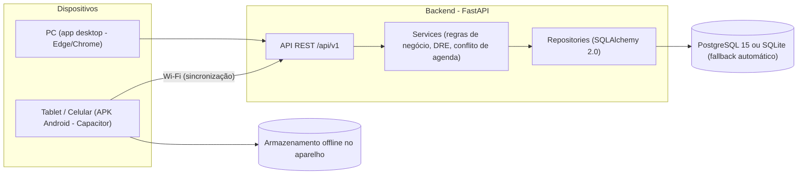

# 🎻 MM3 Wedding Music ERP — Gestão de Casamentos para Banda & Assessoria Musical

Sistema completo (web, desktop e Android) para gerenciar a operação de uma **banda / assessoria musical de casamentos**: agenda de cerimônias, escala de músicos, repertório, playbacks, sonorização e o financeiro de cada evento — funcionando **inclusive offline, em Modo Avião**, durante a cerimônia.

> Projeto real criado para o dia a dia da MM3 Música: roda no computador do escritório e sincroniza pelo Wi-Fi com tablet (Redmi Pad Pro) e celular (Poco X6).


---

## ✨ Funcionalidades

| Módulo | O que faz |
|---|---|
| **Dashboard** | Faturamento do mês, lucro líquido previsto, casamentos do ano, cachês pendentes, próximos casamentos e alertas de vencimento. |
| **Casamentos** | Visão em tabela (filtros por mês, status e formação) e em calendário mensal. **Detecção automática de conflito de agenda** (sobreposição ou margem < 90 min entre eventos). |
| **Visão 360º do Casamento** | Abas de Dados & Contrato, Escala de Músicos, Repertório da Cerimônia, Equipamentos de Som e Resumo Financeiro. |
| **Escala de Músicos** | Cachê pré-preenchido e editável por evento, taxa de deslocamento, confirmação de presença, baixa rápida de pagamento e alerta de músico escalado em dois eventos no mesmo horário. |
| **Repertório** | Músicas por momento da cerimônia (entrada da noiva, alianças, saída…), tom, BPM, links de YouTube/Spotify e partituras, com reordenação. |
| **Playbacks (VS)** | Upload de MP3/WAV, player integrado, organização por tom/partitura e kits padrão de equipamentos. |
| **Modo Apresentação Ao Vivo** | Tela para o palco que conduz a cerimônia música a música, tocando o playback de cada momento. |
| **Folha de Palco** | Roteiro da cerimônia pronto para imprimir/gerar PDF. |
| **Financeiro (DRE por evento)** | Parcelas dos noivos (sinal, intermediárias, quitação) e cálculo automático de receita, despesas (cachês + deslocamento + som), **lucro líquido e margem %**. Exportação para CSV. |
| **Músicos** | Cadastro com busca e filtro por instrumento, botão de **WhatsApp** (`wa.me`) e **copiar chave PIX**; histórico financeiro de cada músico. |
| **WhatsApp** | Geração automática da mensagem de convocação do músico e do roteiro para o grupo do evento. |
| **Offline / Multi-dispositivo** | App Android nativo com banco local; sincronização com o PC pelo Wi-Fi ou por arquivo de backup (.json) — funciona em Modo Avião. |

## 🏗️ Arquitetura



- **Backend** em camadas: `models` → `schemas` (Pydantic v2) → `repositories` → `services` → `api/v1/endpoints`, com autenticação **JWT** (PyJWT + bcrypt).
- **Banco**: PostgreSQL 15 via Docker; se ele não estiver rodando, o sistema cai automaticamente para **SQLite** local — ideal para uso em casa sem Docker.
- **Frontend**: React 18 + Vite + TypeScript + Tailwind, servido pelo próprio FastAPI em produção.
- **Mobile**: o mesmo frontend empacotado com **Capacitor** em um APK Android, com camada de dados offline (`offlineStore.ts`).

## 📁 Estrutura

```
├── backend/                 # API FastAPI
│   └── app/
│       ├── api/v1/endpoints # auth, dashboard, eventos, musicos, playbacks
│       ├── core/            # config, database (fallback SQLite), security (JWT)
│       ├── models/          # modelos SQLAlchemy
│       ├── schemas/         # schemas Pydantic
│       ├── repositories/    # acesso a dados
│       └── services/        # regras de negócio (DRE, conflitos, escalas)
├── frontend/                # React + Vite + TS + Tailwind
│   ├── src/pages            # Dashboard, Casamentos, Detalhe 360º, Músicos, Playbacks
│   ├── src/services         # api.ts (Axios) e offlineStore.ts
│   └── android/             # projeto Android (Capacitor)
├── desktop-app/             # scripts que abrem o sistema como app do Windows
├── scripts/                 # preparação automática do JDK/Android SDK
├── schema_banco_dados.sql   # modelagem relacional oficial (PostgreSQL)
├── 02-seed.sql              # dados fictícios de exemplo
└── docker-compose.yml       # PostgreSQL 15
```

## 🚀 Como rodar

### Pré-requisitos
- Python 3.11+
- Node.js 18+ (LTS)
- (Opcional) Docker, para usar PostgreSQL

### Jeito rápido (Windows)
1. Dê dois cliques em **`PREPARAR_COMPUTADOR_CASA.bat`** — cria o ambiente Python, instala as dependências e cria o atalho *Gestão de Casamentos* na Área de Trabalho.
2. Para acessar pelo tablet/celular, execute **`LIBERAR_FIREWALL_TABLET_CELULAR.bat`** como administrador e abra **`INICIAR_SISTEMA_REDE.bat`** — ele mostra o IP para usar nos aparelhos.

### Manual
```bash
# Backend
cd backend
python -m venv .venv
.venv\Scripts\activate          # Linux/macOS: source .venv/bin/activate
pip install -r requirements.txt
copy .env.example .env          # ajuste SECRET_KEY e o banco
python seed.py                  # (opcional) dados fictícios de exemplo
cd ..
uvicorn app.main:app --app-dir backend --host 0.0.0.0 --port 8000

# Frontend (desenvolvimento)
cd frontend
npm install
npm run dev                     # http://localhost:5173
```

Para usar PostgreSQL: `docker compose up -d` (o schema e o seed são carregados automaticamente).

A documentação interativa da API fica em **http://localhost:8000/docs** (Swagger).

### 📱 Gerar o APK Android
Execute **`GERAR_APK_ANDROID.bat`**. Na primeira vez ele baixa sozinho o JDK 21 e o Android SDK; depois compila o frontend, sincroniza com o Capacitor e gera `Gestao-de-Casamentos.apk`.

## 🔌 Principais endpoints

| Método | Rota | Descrição |
|---|---|---|
| `POST` | `/api/v1/auth/login` | Login (JWT) |
| `GET` | `/api/v1/dashboard` | Indicadores do painel |
| `GET` | `/api/v1/eventos/verificar-conflito` | Verifica conflito de agenda |
| `GET` | `/api/v1/eventos/{id}/resumo-financeiro` | DRE do casamento |
| `PUT` | `/api/v1/eventos/{id}/escalas/{escala_id}` | Atualiza escala/pagamento do músico |
| `GET/POST` | `/api/v1/musicos` | Listagem e cadastro de músicos |
| `GET` | `/api/v1/playbacks` | Biblioteca de playbacks |

## 🧠 Regras de negócio em destaque

- **Conflito de agenda:** um casamento conflita com outro não cancelado na mesma data se a janela *chegada da banda → término previsto* (ou início + 2h) se sobrepõe ou fica a menos de 90 minutos.
- **DRE automático por evento:**
  `lucro líquido = valor do contrato − (cachês + deslocamento + sonorização)` e `margem % = lucro / receita × 100` — músicos que recusaram não entram no custo.
- **Baixa de pagamento:** ao marcar um cachê como pago, a data de pagamento é preenchida automaticamente.

## 🔒 Privacidade

O banco de dados real, os áudios de playback e o arquivo `.env` **não fazem parte do repositório**. Os dados de exemplo (`02-seed.sql` / `seed.py`) são fictícios.

---

Desenvolvido por **Micael Nascimento** · [LinkedIn](https://www.linkedin.com/in/SEU-USUARIO) · micael.nascimento9523@gmail.com
